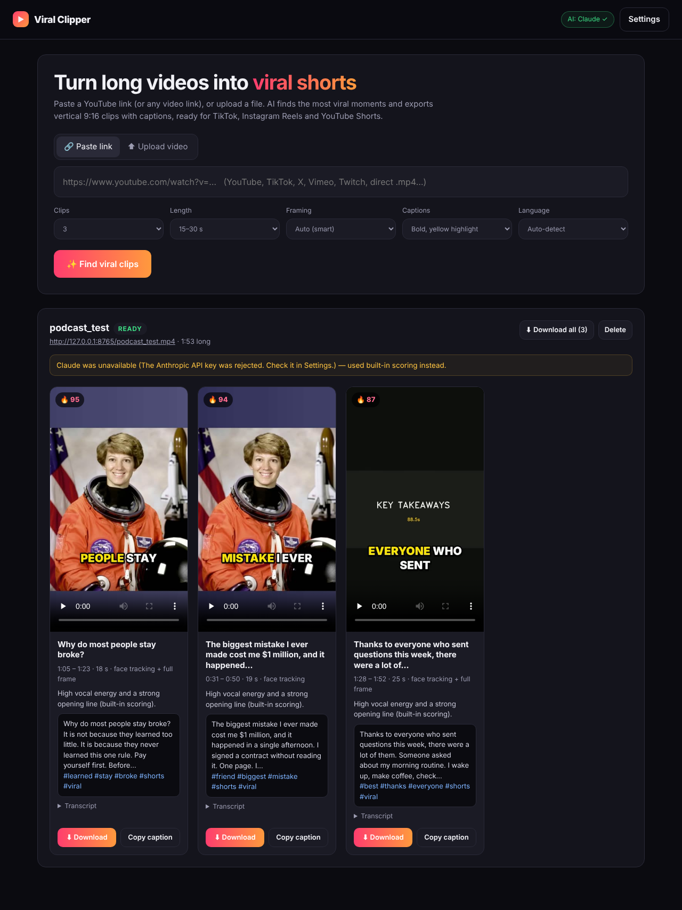

# Viral Clipper

A website that runs on your own computer. Paste a YouTube link, any other video link, or upload a video file.
AI finds the most viral moments and gives you **vertical 9:16 clips with animated captions**, ready to upload to
**TikTok, Instagram Reels and YouTube Shorts**.



## What it does

1. **Downloads** the video (YouTube, TikTok, X/Twitter, Vimeo, Twitch VODs, Instagram, direct `.mp4` links and
   [1,000+ other sites](https://github.com/yt-dlp/yt-dlp/blob/master/supportedsites.md)), or takes your upload.
2. **Transcribes** the speech with word-level timing (Whisper, runs locally, 90+ languages).
3. **Finds the viral moments.** Claude reads the timestamped transcript, along with a vocal-energy signal, and
   picks self-contained moments with a strong hook in the first seconds and a payoff at the end. Each pick gets a
   viral score, a title, an upload caption and hashtags. Without an API key, a built-in scorer is used instead,
   based on vocal energy, hook words and pacing.
4. **Reframes to vertical.** It tracks the speaker's face and pans smoothly like a camera operator. Shots
   without a face (slides, gameplay, b-roll) switch to a full-frame layout over a blurred background.
5. **Burns in captions** in the bold word-by-word highlight style that performs well on short-form platforms.
6. **Exports platform-ready files:** 1080×1920, 30 fps, H.264 High + AAC 48 kHz, loudness-normalized to −14 LUFS
   (the level TikTok, YouTube and Instagram play at), with `faststart` enabled for instant playback.

Download clips one at a time or all at once as a ZIP that includes the titles, captions and hashtags.

## Windows: download the app (easiest)

Go to [**Releases**](https://github.com/txgman/viral-clipper/releases/latest), download
`ViralClipper-Setup-….exe` and run it. Python and FFmpeg are not needed; everything is included. The app opens
in your browser. A black window also opens and shows the app's address. Keep it open while you use the app, and
close it to quit. Your clips are saved in `%LOCALAPPDATA%\ViralClipper`.

Windows may show "Windows protected your PC" because the app isn't code-signed. Click **More info → Run anyway**.

Prefer not to install? Download `ViralClipper-Portable-….zip`, unzip it, and run `ViralClipper.exe`.

## Run from source (Windows, macOS, Linux)

### Setup (one time)

You need **Python 3.10+**, **FFmpeg**, and, for YouTube links, **Deno** or **Node.js**.

| | Install command |
|---|---|
| **Windows** | `winget install Python.Python.3.12 Gyan.FFmpeg DenoLand.Deno` |
| **macOS** | `brew install python ffmpeg deno` |
| **Ubuntu/Debian** | `sudo apt install python3 python3-venv ffmpeg nodejs` |

### Start it

- **Windows:** double-click `run.bat`
- **macOS / Linux:** run `./run.sh` in a terminal

The first start installs everything, which takes a few minutes. Your browser then opens **http://localhost:8000**.
The first video you process also downloads the speech model (about 500 MB for the default "small" model).

## Turn on Claude (recommended)

Click **Settings** in the app and paste an Anthropic API key from https://console.anthropic.com/.
You can also set the `ANTHROPIC_API_KEY` environment variable before starting. Clips are picked by
Claude Opus 5.5. Analyzing an hour-long video typically costs well under $0.50 in API usage.

## Options

| Option | What it does |
|---|---|
| Clips | How many clips to make (best first) |
| Length | 15–30 s, 20–60 s, 30–90 s, or 1–3 min |
| Framing | **Auto** (face tracking where there's a face, full frame elsewhere), **Follow face**, **Full frame + blurred background** (best for screen recordings and gameplay), **Center crop** |
| Captions | Yellow or green active-word highlight, all white, or none |
| Language | Auto-detect, or force a language |

In **Settings** you can pick a speech model: `tiny` and `base` are fastest, `small` is the default, and
`medium` and `large-v3` are the most accurate. An NVIDIA GPU is used automatically if CUDA is installed.

## Speed

On a 4-core laptop CPU with the `small` model, transcription runs at about 6× real time (a 1-hour video takes
about 10 minutes), and each 30-second clip renders in about 20 seconds. A GPU makes transcription much faster.

## Troubleshooting

- **"Sign in to confirm you're not a bot"** (YouTube): in Settings, set *Use cookies from browser* to the
  browser where you're logged in to YouTube.
- **YouTube download fails, or only low quality is available:** install Deno (`winget install DenoLand.Deno` /
  `brew install deno`), then update the downloader: `.venv/bin/pip install -U "yt-dlp[default]"`
  (Windows: `.venv\Scripts\pip install -U "yt-dlp[default]"`). YouTube changes often, and updating fixes most issues.
- **Slow:** choose the `base` or `tiny` speech model in Settings.
- **Run on another port:** `./run.sh --port 9000`. To use it from another device on your network:
  `./run.sh --host 0.0.0.0`. There is no login, so only do this on a network you trust.

## Privacy

Everything runs on your computer. If you add an Anthropic API key, only the video's **transcript text and title**
are sent to Claude, never the video itself. Videos and clips are stored in the `data/` folder. Deleting a video in
the app removes its files.

Only clip videos you have the rights to use.

## Project layout

```
app/
  main.py        web server + API
  jobs.py        background job queue and pipeline
  download.py    yt-dlp downloader
  transcribe.py  faster-whisper transcription
  selector.py    viral-moment picking (Claude + built-in scorer)
  render.py      face tracking, vertical reframing, captions, encoding
  media.py       ffmpeg helpers
  static/        the website (HTML/CSS/JS)
packaging/       Windows .exe build (PyInstaller spec, installer, end-to-end test)
.github/workflows/build-windows.yml   builds, tests and publishes the Windows app on every push
```

Caption font: Inter (SIL Open Font License, see `app/assets/fonts/OFL.txt`).
